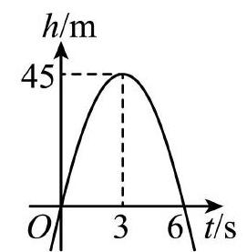
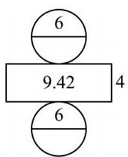

# AVP0550 — Single visual target

MV-MATH:624_1 / MV-MATH:552_1 · different type · Numeric representation and conversion

## Shared or similar visual information

The numerical notation 6 in both images.

## Evidence locations

- Left image: The 6 on the t/s axis beneath the curve's positive horizontal-axis crossing.
- Right image: The 6 above the line spanning the top circular disk.

## Mathematical meanings

Left image: The curve crosses back to zero height at time six seconds. Right image: The top disk's diameter has length value 6.

## Same mathematical meanings

no

## Rationales

The left context gives the number the role of time in seconds, while the right context gives it the role of geometric length.

Only the selected target is annotated. AI visual-review draft; not independently double-annotated by humans.
