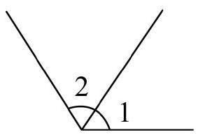

# AVP0551 — Single visual target

MV-MATH:465_1 / MathVista:329 · different type · Numeric representation and conversion

## Shared or similar visual information

The numerical notation 2 in both images.

## Evidence locations

- Left image: The standalone 2 in the arc-marked region between the two upward rays.
- Right image: The subscript 2 in y = log₂(x) beside the blue curve.

## Mathematical meanings

Left image: The numeral 2 identifies the selected angle region. Right image: The logarithm in the curve's equation has base 2.

## Same mathematical meanings

no

## Rationales

The left context gives the number the role of identifier of a marked angle, while the right context gives it the role of logarithm base.

Only the selected target is annotated. AI visual-review draft; not independently double-annotated by humans.
