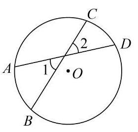
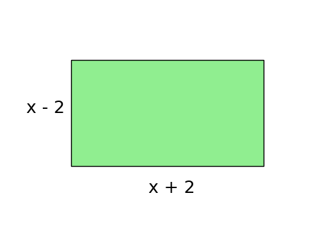

# AVP0553 — Single visual target

MV-MATH:221_1 / DynaMath:65 · same type · Numeric representation and conversion

## Shared or similar visual information

The numerical notation 2 in both images.

## Evidence locations

- Left image: The standalone 2 inside the upper-right angle where two chords cross.
- Right image: The positive 2 added in x + 2 beneath the rectangle's bottom edge.

## Mathematical meanings

Left image: The numeral 2 identifies the upper-right angle region at the chord crossing. Right image: The 2 is an additive constant in the bottom edge's length expression.

## Same mathematical meanings

no

## Rationales

The left context gives the number the role of identifier of a marked angle, while the right context gives it the role of additive constant.

Only the selected target is annotated. AI visual-review draft; not independently double-annotated by humans.
