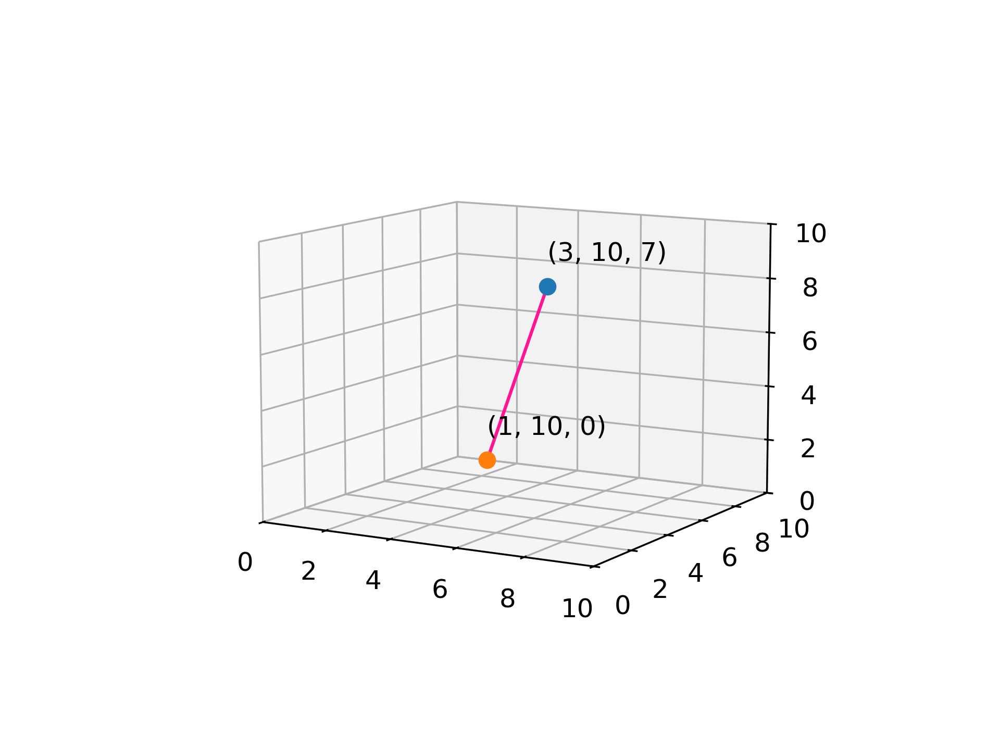
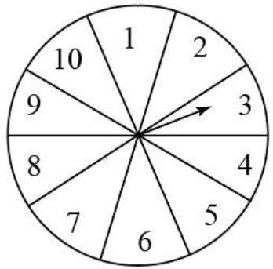

# AVP0554 — Single visual target

DynaMath:318 / MV-MATH:510_1 · different type · Numeric representation and conversion

## Shared or similar visual information

The numerical notation 3 in both images.

## Evidence locations

- Left image: The initial 3 in the blue point label (3, 10, 7).
- Right image: The 3 printed inside the right-hand sector toward which the spinner arrow points.

## Mathematical meanings

Left image: The blue point's first coordinate is 3. Right image: The numeral 3 is the outcome label of that sector on the spinner.

## Same mathematical meanings

no

## Rationales

The left context gives the number the role of horizontal coordinate, while the right context gives it the role of identifier of a spinner outcome.

Only the selected target is annotated. AI visual-review draft; not independently double-annotated by humans.
