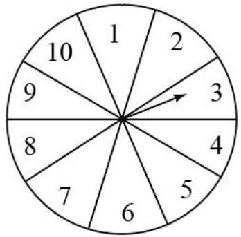
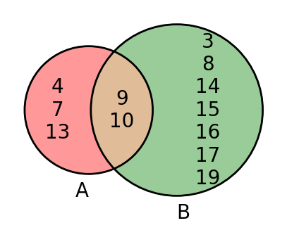

# AVP0555 — Single visual target

MV-MATH:510_1 / DynaMath:473 · different type · Numeric representation and conversion

## Shared or similar visual information

The numerical notation 10 in both images.

## Evidence locations

- Left image: The 10 printed inside the sector near the upper left of the spinner.
- Right image: The 10 in the overlapping region of the two sets.

## Mathematical meanings

Left image: The numeral 10 identifies one outcome sector on the spinner. Right image: The number 10 is a listed element of the intersection.

## Same mathematical meanings

no

## Rationales

The left context gives the number the role of identifier of a spinner outcome, while the right context gives it the role of listed set element.

Only the selected target is annotated. AI visual-review draft; not independently double-annotated by humans.
