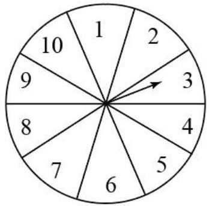
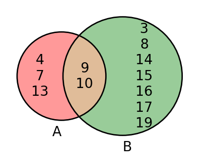

# AVP0555 — Single visual target

MV-MATH:510_1 / DynaMath:473 · different type · Numeric representation and conversion

## Shared or similar visual information

The numerical notation 3.

## Evidence locations

- Left image: The notation 3 appears inside the right-hand sector of the spinner.
- Right image: The notation 3 appears at the top of the B-only region.

## Mathematical meanings

Left image: 3 labels one possible spinner outcome. Right image: 3 belongs to B only.

## Same mathematical meanings

no

## Rationales

The notation on the left represents a possible spinner outcome. The notation on the right represents an element of one set.

Only the selected target is annotated. AI visual-review draft; not independently double-annotated by humans.
