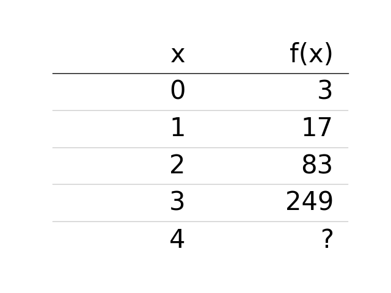
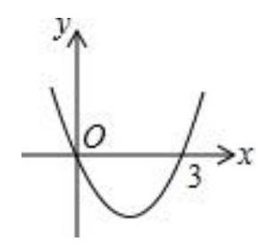

# AVP0556 — Single visual target

DynaMath:108 / MV-MATH:969_1 · different type · Numeric representation and conversion

## Shared or similar visual information

The numerical notation 3 in both images.

## Evidence locations

- Left image: The 3 in the f(x) column in the first data row.
- Right image: The 3 beneath the positive horizontal-axis crossing of the parabola.

## Mathematical meanings

Left image: The table gives function output 3 at input x = 0. Right image: The positive intercept on the horizontal axis has x-coordinate 3.

## Same mathematical meanings

no

## Rationales

The left context gives the number the role of tabulated function output, while the right context gives it the role of horizontal coordinate.

Only the selected target is annotated. AI visual-review draft; not independently double-annotated by humans.
