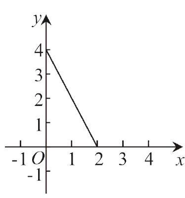
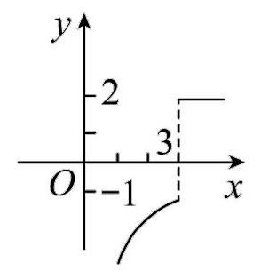

# AVP0557 — Single visual target

MV-MATH:1999_1 / MV-MATH:94_1 · same type · Numeric representation and conversion

## Shared or similar visual information

The numerical notation 2 in both images.

## Evidence locations

- Left image: The 2 under the horizontal-axis tick where the sloping segment ends.
- Right image: The 2 beside the upper labeled tick on the vertical axis.

## Mathematical meanings

Left image: The sloping segment meets the horizontal axis at x-coordinate 2. Right image: The tick marks y-coordinate 2.

## Same mathematical meanings

no

## Rationales

The left context gives the number the role of horizontal coordinate, while the right context gives it the role of vertical coordinate.

Only the selected target is annotated. AI visual-review draft; not independently double-annotated by humans.
