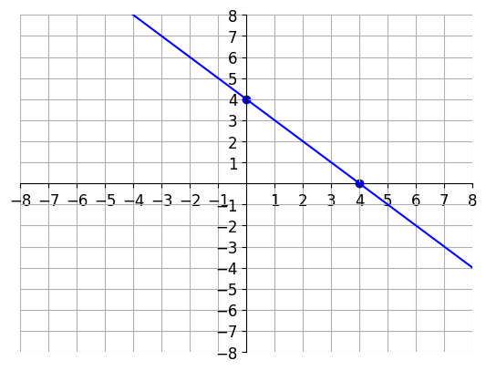
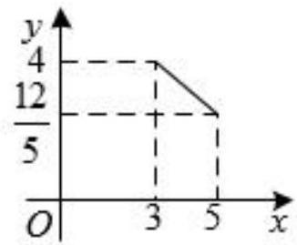

# AVP0558 — Single visual target

DynaMath:96 / MV-MATH:96_1 · same type · Numeric representation and conversion

## Shared or similar visual information

The numerical notation 4 in both images.

## Evidence locations

- Left image: The 4 below the marked point where the blue line meets the horizontal axis.
- Right image: The 4 at the upper horizontal guide meeting the vertical axis.

## Mathematical meanings

Left image: The indicated horizontal-axis intercept has x-coordinate 4. Right image: The left segment endpoint has vertical coordinate 4.

## Same mathematical meanings

no

## Rationales

The left context gives the number the role of horizontal coordinate, while the right context gives it the role of vertical coordinate.

Only the selected target is annotated. AI visual-review draft; not independently double-annotated by humans.
