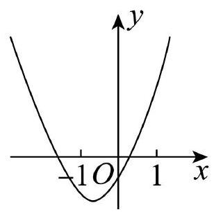
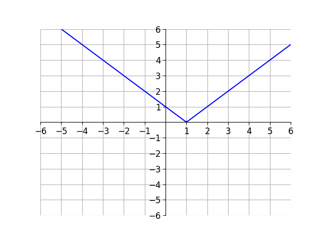

# AVP0559 — Single visual target

MV-MATH:615_1 / DynaMath:78 · same type · Numeric representation and conversion

## Shared or similar visual information

The numerical notations −1 and 1.

## Evidence locations

- Left image: The −1 beneath the negative tick on the horizontal axis to the left of the origin.
- Right image: The 1 beneath the vertex of the blue V on the horizontal axis.

## Mathematical meanings

Left image: The selected horizontal-axis tick marks x-coordinate negative one. Right image: The blue graph's vertex has x-coordinate 1.

## Same mathematical meanings

no

## Rationales

The expressions −1 and 1 have opposite signs, so their complete numerical values differ.

Only the selected target is annotated. AI visual-review draft; not independently double-annotated by humans.
