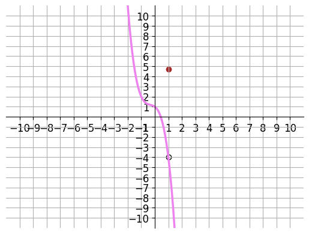
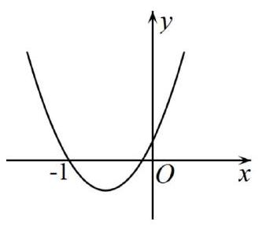

# AVP0560 — Single visual target

DynaMath:143 / MV-MATH:85_1 · same type · Numeric representation and conversion

## Shared or similar visual information

The numerical notations 1 and −1.

## Evidence locations

- Left image: The 1 beneath the red dot and open circle aligned on the first positive vertical grid line.
- Right image: The −1 below the left crossing of the parabola and the horizontal axis.

## Mathematical meanings

Left image: The two highlighted marks share x-coordinate 1. Right image: The left intercept has x-coordinate negative one.

## Same mathematical meanings

no

## Rationales

The expressions 1 and −1 have opposite signs, so their complete numerical values differ.

Only the selected target is annotated. AI visual-review draft; not independently double-annotated by humans.
