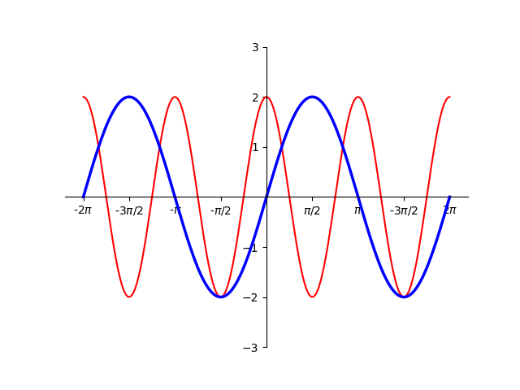
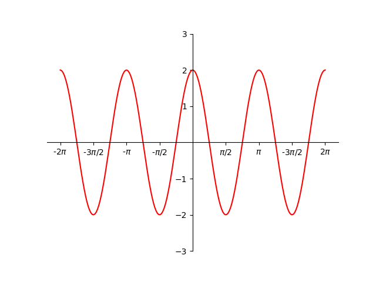

# AVP0561 — Single visual target

DynaMath:14 / DynaMath:12 · same type · Numeric representation and conversion

## Shared or similar visual information

The numerical notations π/2 and −π/2.

## Evidence locations

- Left image: The π/2 beneath the first positive special-value tick of the horizontal axis.
- Right image: The −π/2 below the labeled tick immediately to the left of the vertical axis.

## Mathematical meanings

Left image: The tick denotes horizontal coordinate π/2. Right image: The tick denotes horizontal coordinate negative π/2.

## Same mathematical meanings

no

## Rationales

The expressions π/2 and −π/2 have opposite signs, so their complete numerical values differ.

Only the selected target is annotated. AI visual-review draft; not independently double-annotated by humans.
