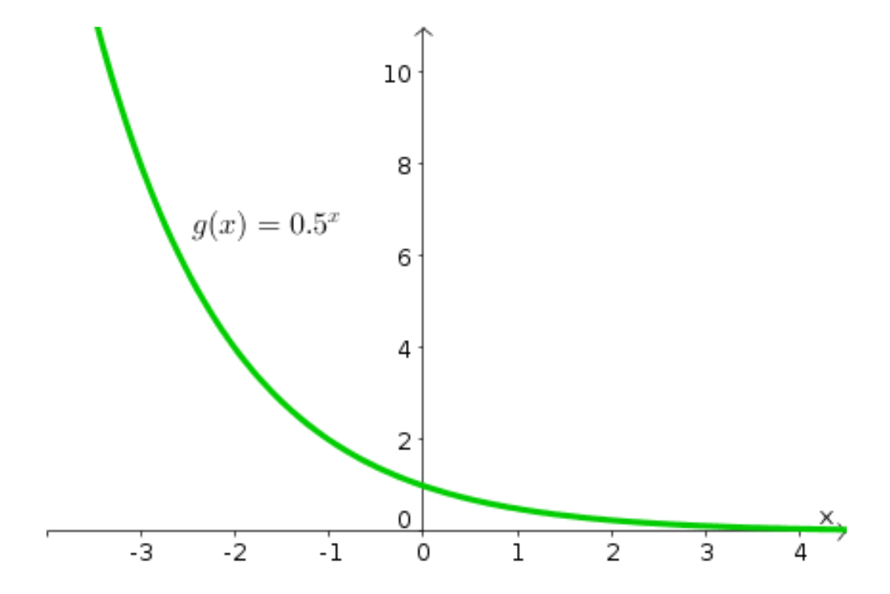
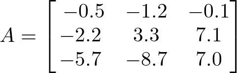

# AVP0562 — Single visual target

MathVista:154 / DynaMath:474 · different type · Numeric representation and conversion

## Shared or similar visual information

The numerical notations 0.5 and −0.5.

## Evidence locations

- Left image: The decimal 0.5 in the base position of the equation beside the green curve.
- Right image: The −0.5 in the top-left position of matrix A.

## Mathematical meanings

Left image: The exponential function has base one half. Right image: Matrix A has entry negative one half at row 1, column 1.

## Same mathematical meanings

no

## Rationales

The expressions 0.5 and −0.5 have opposite signs, so their complete numerical values differ. The left context gives it the role of exponential base, while the right context gives it the role of matrix entry.

Only the selected target is annotated. AI visual-review draft; not independently double-annotated by humans.
