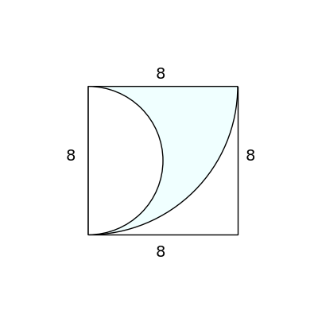
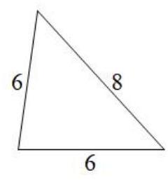

# AVP0564 — Single visual target

DynaMath:112 / MV-MATH:59_1 · same type · Numeric representation and conversion

## Shared or similar visual information

The numerical notation 8 in both images.

## Evidence locations

- Left image: The 8 above the top edge of the square surrounding the two arcs.
- Right image: The 8 beside the right sloping side of the triangle.

## Mathematical meanings

Left image: The top side of the square has length value 8. Right image: The right sloping side has length value 8.

## Same mathematical meanings

yes

## Rationales

In both figures, the label is attached to the indicated span and gives the same length value, 8.

Only the selected target is annotated. AI visual-review draft; not independently double-annotated by humans.
