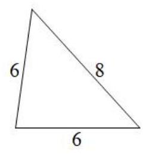
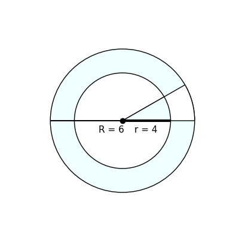

# AVP0565 — Single visual target

MV-MATH:59_1 / DynaMath:113 · same type · Numeric representation and conversion

## Shared or similar visual information

The numerical notation 6 in both images.

## Evidence locations

- Left image: The 6 below the triangle's horizontal base.
- Right image: The 6 in R = 6 near the center of the annulus.

## Mathematical meanings

Left image: The triangle base has length value 6. Right image: The outer circle radius has length value 6.

## Same mathematical meanings

yes

## Rationales

In both figures, the label is attached to the indicated span and gives the same length value, 6.

Only the selected target is annotated. AI visual-review draft; not independently double-annotated by humans.
