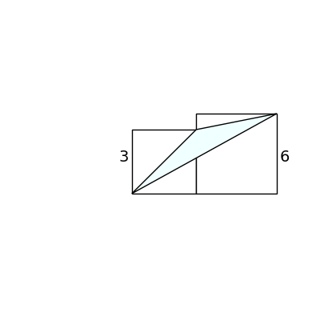
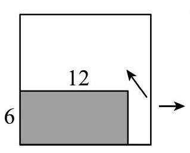

# AVP0566 — Single visual target

DynaMath:194 / MV-MATH:934_1 · same type · Numeric representation and conversion

## Shared or similar visual information

The numerical notation 6 in both images.

## Evidence locations

- Left image: The 6 next to the right-hand vertical side of the overlapping-rectangle diagram.
- Right image: The 6 beside the left edge of the shaded rectangle.

## Mathematical meanings

Left image: The right-hand vertical side has length value 6. Right image: The left edge of the shaded rectangle has length value 6.

## Same mathematical meanings

yes

## Rationales

In both figures, the label is attached to the indicated span and gives the same length value, 6.

Only the selected target is annotated. AI visual-review draft; not independently double-annotated by humans.
