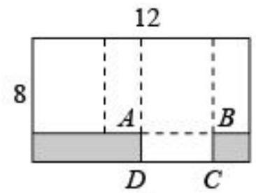
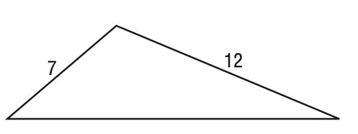

# AVP0567 — Single visual target

MV-MATH:10_3 / MathVista:615 · same type · Numeric representation and conversion

## Shared or similar visual information

The numerical notation 12 in both images.

## Evidence locations

- Left image: The 12 above the long top edge of the rectangle.
- Right image: The 12 beside the right sloping side of the triangle.

## Mathematical meanings

Left image: The top edge of the rectangle has length value 12. Right image: The indicated triangle side has length value 12.

## Same mathematical meanings

yes

## Rationales

In both figures, the label is attached to the indicated span and gives the same length value, 12.

Only the selected target is annotated. AI visual-review draft; not independently double-annotated by humans.
