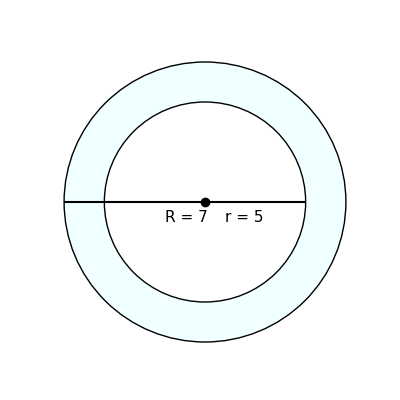
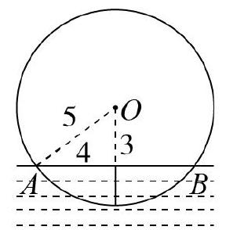

# AVP0568 — Single visual target

DynaMath:53 / MV-MATH:208_2 · same type · Numeric representation and conversion

## Shared or similar visual information

The numerical notation 5 in both images.

## Evidence locations

- Left image: The 5 in r = 5 near the center of the smaller circle.
- Right image: The 5 beside dashed segment AO running from the circle edge to O.

## Mathematical meanings

Left image: The inner circle radius has length value 5. Right image: Radius AO has length value 5.

## Same mathematical meanings

yes

## Rationales

In both figures, the label is attached to the indicated span and gives the same length value, 5.

Only the selected target is annotated. AI visual-review draft; not independently double-annotated by humans.
