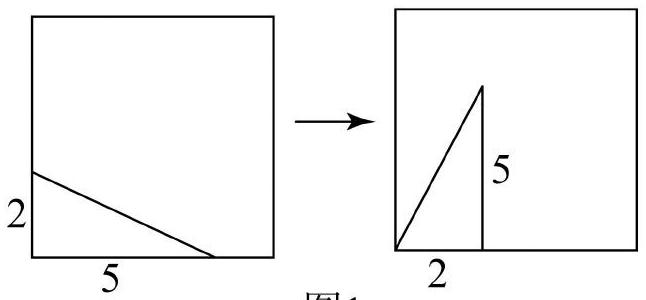
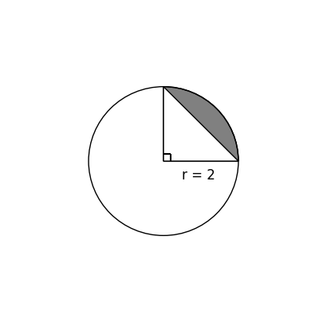

# AVP0569 — Single visual target

MV-MATH:147_1 / DynaMath:97 · same type · Numeric representation and conversion

## Shared or similar visual information

The numerical notation 2 in both images.

## Evidence locations

- Left image: The 2 beside the short bottom segment of the right panel.
- Right image: The 2 in r = 2 beneath the horizontal radius.

## Mathematical meanings

Left image: The bottom segment from the lower-left corner to the vertical segment has length value 2. Right image: The circle radius has length value 2.

## Same mathematical meanings

yes

## Rationales

In both figures, the label is attached to the indicated span and gives the same length value, 2.

Only the selected target is annotated. AI visual-review draft; not independently double-annotated by humans.
