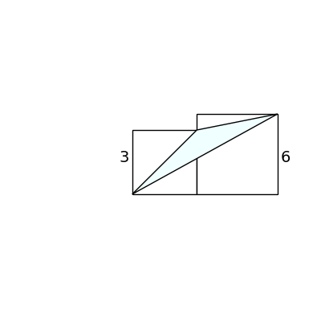
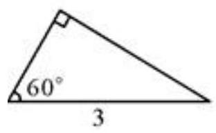

# AVP0570 — Single visual target

DynaMath:194 / MV-MATH:484_1 · same type · Numeric representation and conversion

## Shared or similar visual information

The numerical notation 3 in both images.

## Evidence locations

- Left image: The 3 beside the shorter left vertical side.
- Right image: The 3 below the horizontal base of the right triangle.

## Mathematical meanings

Left image: The left vertical side has length value 3. Right image: The base, opposite the right-angle marker, has length value 3.

## Same mathematical meanings

yes

## Rationales

In both figures, the label is attached to the indicated span and gives the same length value, 3.

Only the selected target is annotated. AI visual-review draft; not independently double-annotated by humans.
