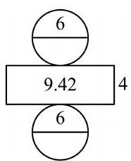
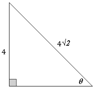

# AVP0571 — Single visual target

MV-MATH:552_1 / MathVerse:370 · different type · Numeric representation and conversion

## Shared or similar visual information

The numerical notation 4 in both images.

## Evidence locations

- Left image: The 4 to the right of the rectangle in the cylinder net.
- Right image: The 4 beside the left vertical leg of the right triangle.

## Mathematical meanings

Left image: The rectangle's short side has length value 4. Right image: The vertical leg has length value 4.

## Same mathematical meanings

yes

## Rationales

In both figures, the label is attached to the indicated span and gives the same length value, 4.

Only the selected target is annotated. AI visual-review draft; not independently double-annotated by humans.
