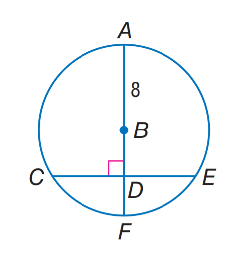
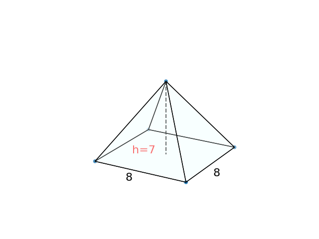

# AVP0572 — Single visual target

MathVista:804 / DynaMath:129 · different type · Numeric representation and conversion

## Shared or similar visual information

The numerical notation 8 in both images.

## Evidence locations

- Left image: The 8 beside the radius AB in the upper part of the circle.
- Right image: The 8 beside the front-left edge of the pyramid's base.

## Mathematical meanings

Left image: Radius AB has length value 8. Right image: That pyramid base edge has length value 8.

## Same mathematical meanings

yes

## Rationales

In both figures, the label is attached to the indicated span and gives the same length value, 8.

Only the selected target is annotated. AI visual-review draft; not independently double-annotated by humans.
