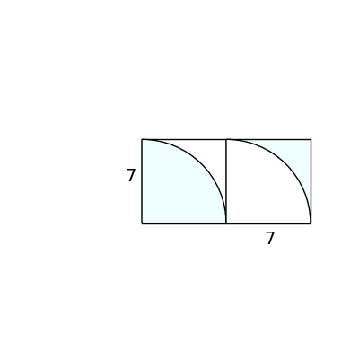
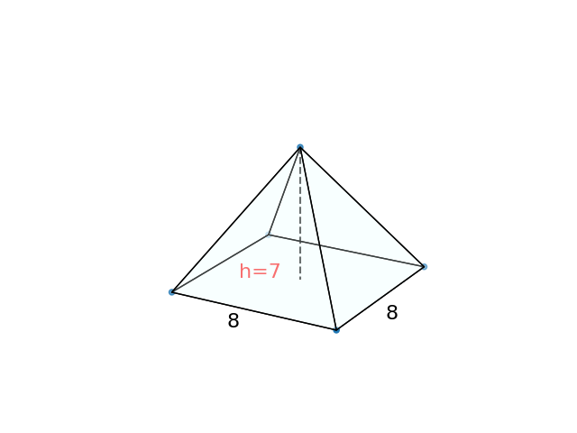

# AVP0573 — Single visual target

DynaMath:174 / DynaMath:129 · different type · Numeric representation and conversion

## Shared or similar visual information

The numerical notation 7 in both images.

## Evidence locations

- Left image: The 7 beneath the bottom edge of the right square in the two-square diagram.
- Right image: The 7 in h=7 next to the interior altitude of the pyramid.

## Mathematical meanings

Left image: The bottom side of the right square has length value 7. Right image: The height of the pyramid has length value 7.

## Same mathematical meanings

yes

## Rationales

In both figures, the label is attached to the indicated span and gives the same length value, 7.

Only the selected target is annotated. AI visual-review draft; not independently double-annotated by humans.
