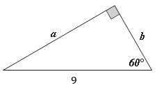
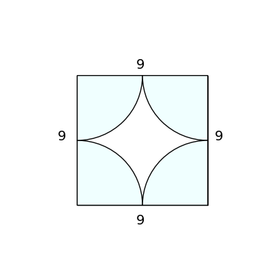

# AVP0574 — Single visual target

MathVerse:377 / DynaMath:153 · same type · Numeric representation and conversion

## Shared or similar visual information

The numerical notation 9 in both images.

## Evidence locations

- Left image: The 9 beneath the horizontal base of the right triangle.
- Right image: The 9 above the top side of the square framing four arcs.

## Mathematical meanings

Left image: The base side has length value 9. Right image: The top side of the square has length value 9.

## Same mathematical meanings

yes

## Rationales

In both figures, the label is attached to the indicated span and gives the same length value, 9.

Only the selected target is annotated. AI visual-review draft; not independently double-annotated by humans.
