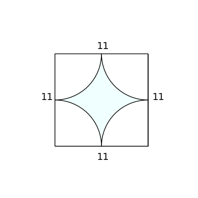
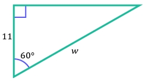

# AVP0575 — Single visual target

DynaMath:154 / MathVerse:371 · same type · Numeric representation and conversion

## Shared or similar visual information

The numerical notation 11 in both images.

## Evidence locations

- Left image: The 11 above the top side of the square framing the curved shape.
- Right image: The 11 beside the left vertical side of the outlined triangle.

## Mathematical meanings

Left image: The square's top side has length value 11. Right image: The left vertical side has length value 11.

## Same mathematical meanings

yes

## Rationales

In both figures, the label is attached to the indicated span and gives the same length value, 11.

Only the selected target is annotated. AI visual-review draft; not independently double-annotated by humans.
