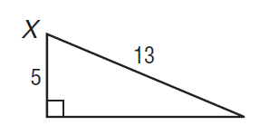
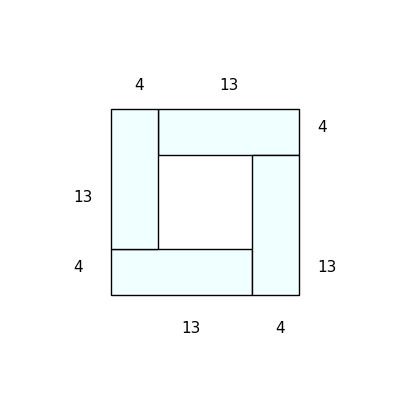

# AVP0576 — Single visual target

MathVista:333 / DynaMath:57 · same type · Numeric representation and conversion

## Shared or similar visual information

The numerical notation 13 in both images.

## Evidence locations

- Left image: The 13 beside the hypotenuse of the right triangle.
- Right image: The 13 above the right portion of the top side of the rectangular tiling.

## Mathematical meanings

Left image: The hypotenuse has length value 13. Right image: The upper-right rectangle's top edge has length value 13.

## Same mathematical meanings

yes

## Rationales

In both figures, the label is attached to the indicated span and gives the same length value, 13.

Only the selected target is annotated. AI visual-review draft; not independently double-annotated by humans.
