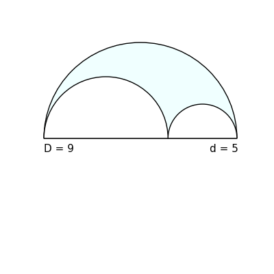
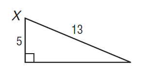

# AVP0577 — Single visual target

DynaMath:122 / MathVista:333 · same type · Numeric representation and conversion

## Shared or similar visual information

The numerical notation 5 in both images.

## Evidence locations

- Left image: The 5 in d = 5 below the smaller right-hand semicircle.
- Right image: The 5 beside the left vertical side of the right triangle.

## Mathematical meanings

Left image: The smaller semicircle's diameter has length value 5. Right image: The vertical leg has length value 5.

## Same mathematical meanings

yes

## Rationales

In both figures, the label is attached to the indicated span and gives the same length value, 5.

Only the selected target is annotated. AI visual-review draft; not independently double-annotated by humans.
