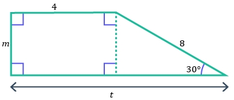
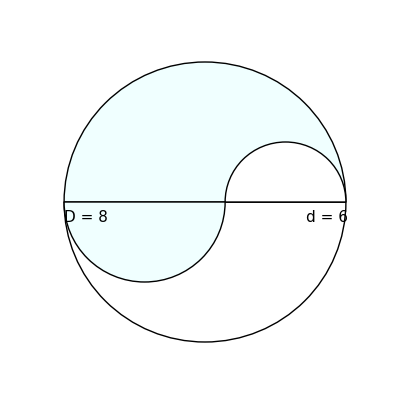

# AVP0578 — Single visual target

MathVerse:379 / DynaMath:190 · same type · Numeric representation and conversion

## Shared or similar visual information

The numerical notation 8 in both images.

## Evidence locations

- Left image: The 8 beside the right sloping edge of the compound outline.
- Right image: The 8 in D = 8 on the left part of the horizontal diameter line.

## Mathematical meanings

Left image: The right sloping side has length value 8. Right image: The displayed diameter D has length value 8.

## Same mathematical meanings

yes

## Rationales

In both figures, the label is attached to the indicated span and gives the same length value, 8.

Only the selected target is annotated. AI visual-review draft; not independently double-annotated by humans.
