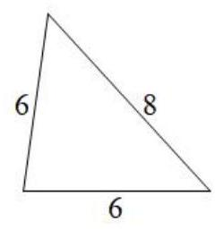
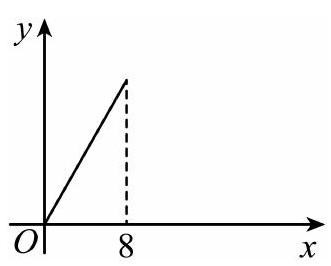

# AVP0579 — Single visual target

MV-MATH:59_1 / MV-MATH:103_1 · different type · Numeric representation and conversion

## Shared or similar visual information

The numerical notation 8 in both images.

## Evidence locations

- Left image: The 8 beside the right sloping side of the triangle.
- Right image: The 8 beneath the dashed vertical guide that drops from the upper endpoint of the sloping line.

## Mathematical meanings

Left image: The right sloping side has length value 8. Right image: The marked line endpoint has x-coordinate 8.

## Same mathematical meanings

no

## Rationales

The left context gives the number the role of geometric length, while the right context gives it the role of horizontal coordinate.

Only the selected target is annotated. AI visual-review draft; not independently double-annotated by humans.
