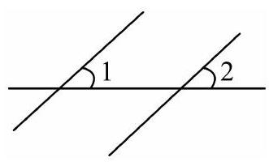
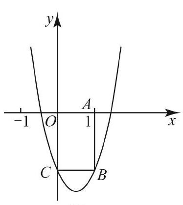

# AVP0580 — Single visual target

MV-MATH:471_1 / MV-MATH:91_1 · different type · Numeric representation and conversion

## Shared or similar visual information

The numerical notation 1 in both images.

## Evidence locations

- Left image: The standalone 1 inside the angle at the left intersection, above the horizontal line.
- Right image: The 1 below A on the horizontal axis, at the top of segment AB.

## Mathematical meanings

Left image: The numeral 1 identifies the selected angle region. Right image: The vertical guide AB is located at x-coordinate 1.

## Same mathematical meanings

no

## Rationales

The left context gives the number the role of identifier of a marked angle, while the right context gives it the role of horizontal coordinate.

Only the selected target is annotated. AI visual-review draft; not independently double-annotated by humans.
