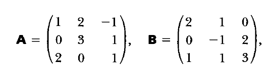

# AVP0581 — Single visual target

MathVista:117 / MathVista:577 · different type · Numeric representation and conversion

## Shared or similar visual information

The numerical notation 2 in both images.

## Evidence locations

- Left image: The second component 2 in the point label (3,2) at the right peak.
- Right image: The 2 in the first row and second column of matrix A.

## Mathematical meanings

Left image: The marked peak point has y-coordinate 2. Right image: Matrix A has entry 2 at row 1, column 2.

## Same mathematical meanings

no

## Rationales

The left context gives the number the role of vertical coordinate, while the right context gives it the role of matrix entry.

Only the selected target is annotated. AI visual-review draft; not independently double-annotated by humans.
