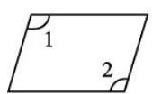
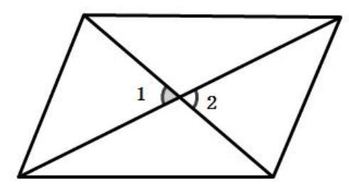

# AVP0583 — Single visual target

MV-MATH:1027_1 / MV-MATH:214_1 · same type · Numeric representation and conversion

## Shared or similar visual information

The numerical notation 1 in both images.

## Evidence locations

- Left image: The standalone 1 just below the marked upper-left corner of the parallelogram.
- Right image: The standalone 1 inside the left angle at the crossing of the diagonals.

## Mathematical meanings

Left image: The numeral 1 identifies the upper-left angle region. Right image: The numeral 1 identifies the left-hand angle region.

## Same mathematical meanings

yes

## Rationales

The numeral 1 appears next to an angle arc in both diagrams and identifies the marked angle region in each.

Only the selected target is annotated. AI visual-review draft; not independently double-annotated by humans.
