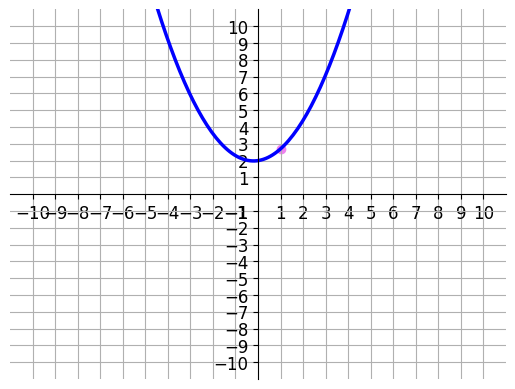
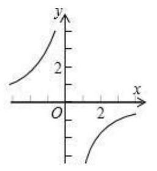

# AVP0584 — Single visual target

DynaMath:105 / MV-MATH:955_1 · same type · Numeric representation and conversion

## Shared or similar visual information

The numerical notation 2 in both images.

## Evidence locations

- Left image: The 2 on the vertical axis where the blue parabola has its bottom point.
- Right image: The 2 at the positive labeled tick on the vertical axis.

## Mathematical meanings

Left image: The parabola's vertex has y-coordinate 2. Right image: The tick marks y-coordinate 2.

## Same mathematical meanings

yes

## Rationales

Both cues identify the same vertical coordinate value, 2. The evidence is the selected axis position or coordinate component in each image.

Only the selected target is annotated. AI visual-review draft; not independently double-annotated by humans.
