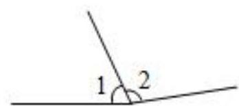
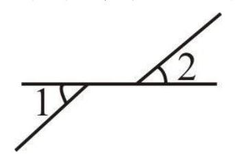

# AVP0586 — Single visual target

MV-MATH:951_1 / MV-MATH:481_1 · same type · Numeric representation and conversion

## Shared or similar visual information

The numerical notation 1 in both images.

## Evidence locations

- Left image: The standalone 1 above the baseline on the left side of the central ray.
- Right image: The standalone 1 below the horizontal line at the left intersection.

## Mathematical meanings

Left image: The numeral 1 identifies the left-hand angle region. Right image: The numeral 1 identifies the lower-left marked angle.

## Same mathematical meanings

yes

## Rationales

The numeral 1 appears next to an angle arc in both diagrams and identifies the marked angle region in each.

Only the selected target is annotated. AI visual-review draft; not independently double-annotated by humans.
