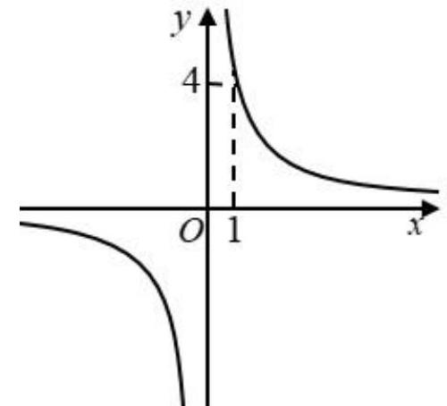
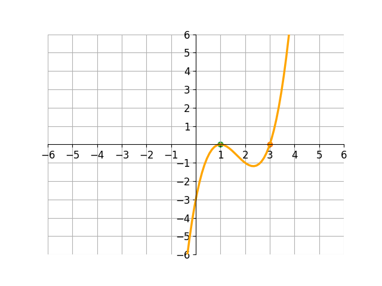

# AVP0587 — Single visual target

MV-MATH:952_1 / DynaMath:193 · same type · Numeric representation and conversion

## Shared or similar visual information

The numerical notation 1 in both images.

## Evidence locations

- Left image: The 1 under the dashed vertical guide from the upper-right branch.
- Right image: The 1 beneath the left-hand green point on the horizontal axis.

## Mathematical meanings

Left image: The dashed vertical guide selects x-coordinate 1. Right image: The left-hand marked zero of the curve has x-coordinate 1.

## Same mathematical meanings

yes

## Rationales

Both cues identify the same horizontal coordinate value, 1. The evidence is the selected axis position or coordinate component in each image.

Only the selected target is annotated. AI visual-review draft; not independently double-annotated by humans.
