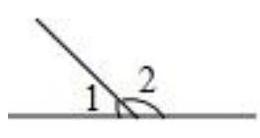
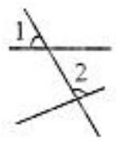

# AVP0588 — Single visual target

MV-MATH:1015_1 / MV-MATH:761_1 · same type · Numeric representation and conversion

## Shared or similar visual information

The numerical notation 2 in both images.

## Evidence locations

- Left image: The standalone 2 above the arc extending from the slanted ray toward the rightward horizontal ray.
- Right image: The standalone 2 above the arc at the lower intersection.

## Mathematical meanings

Left image: The numeral 2 identifies the right-hand angle region. Right image: The numeral 2 identifies the selected lower-intersection angle.

## Same mathematical meanings

yes

## Rationales

The numeral 2 appears next to an angle arc in both diagrams and identifies the marked angle region in each.

Only the selected target is annotated. AI visual-review draft; not independently double-annotated by humans.
