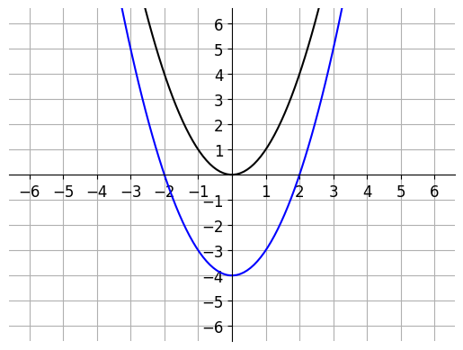

# AVP0589 — Single visual target

DynaMath:160 / MathVista:767 · different type · Numeric representation and conversion

## Shared or similar visual information

The numerical notation −4 in both images.

## Evidence locations

- Left image: The −4 on the vertical axis beside the lowest point of the blue parabola.
- Right image: The second component −4 in the blue point label (3,−4).

## Mathematical meanings

Left image: The blue parabola's vertex has y-coordinate negative four. Right image: The blue point on the circle has y-coordinate negative four.

## Same mathematical meanings

yes

## Rationales

Both cues identify the same vertical coordinate value, −4. The evidence is the selected axis position or coordinate component in each image.

Only the selected target is annotated. AI visual-review draft; not independently double-annotated by humans.
