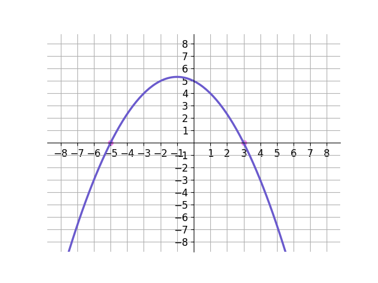
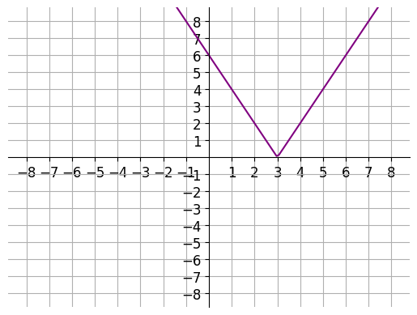

# AVP0590 — Single visual target

DynaMath:110 / DynaMath:101 · same type · Numeric representation and conversion

## Shared or similar visual information

The numerical notation 3 in both images.

## Evidence locations

- Left image: The 3 beside the orange point on the positive horizontal axis.
- Right image: The 3 under the vertex where the two sloping parts of the purple V meet.

## Mathematical meanings

Left image: The positive marked zero of the blue curve has x-coordinate 3. Right image: The vertex of the V has x-coordinate 3.

## Same mathematical meanings

yes

## Rationales

Both cues identify the same horizontal coordinate value, 3. The evidence is the selected axis position or coordinate component in each image.

Only the selected target is annotated. AI visual-review draft; not independently double-annotated by humans.
