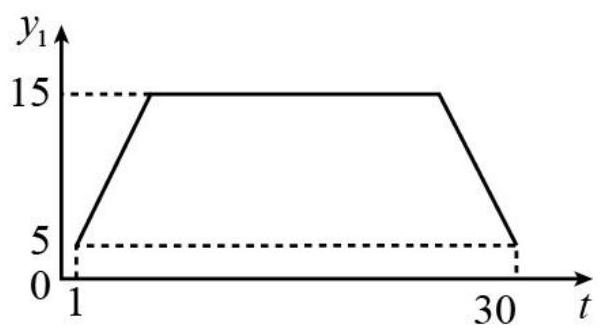
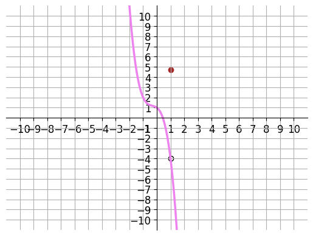

# AVP0591 — Single visual target

MV-MATH:101_1 / DynaMath:143 · same type · Numeric representation and conversion

## Shared or similar visual information

The numerical notation 5 in both images.

## Evidence locations

- Left image: The 5 on the y₁ axis at the level of the lower horizontal dashed guide.
- Right image: The 5 on the vertical axis at the height of the red filled point.

## Mathematical meanings

Left image: The two end positions shown by the graph have vertical-coordinate value 5. Right image: The red filled point has y-coordinate 5.

## Same mathematical meanings

yes

## Rationales

Both cues identify the same vertical coordinate value, 5. The evidence is the selected axis position or coordinate component in each image.

Only the selected target is annotated. AI visual-review draft; not independently double-annotated by humans.
