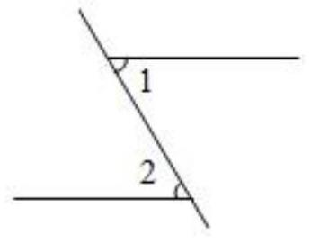
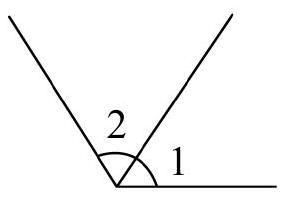

# AVP0592 — Single visual target

MV-MATH:464_1 / MV-MATH:465_1 · same type · Numeric representation and conversion

## Shared or similar visual information

The numerical notation 2 in both images.

## Evidence locations

- Left image: The standalone 2 beside the arc at the lower horizontal line.
- Right image: The standalone 2 in the arc-marked region between the two upward rays.

## Mathematical meanings

Left image: The numeral 2 identifies the selected angle region at the lower crossing. Right image: The numeral 2 identifies the selected angle region.

## Same mathematical meanings

yes

## Rationales

The numeral 2 appears next to an angle arc in both diagrams and identifies the marked angle region in each.

Only the selected target is annotated. AI visual-review draft; not independently double-annotated by humans.
