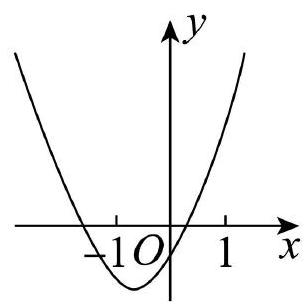
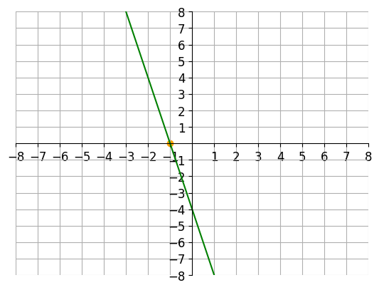

# AVP0593 — Single visual target

MV-MATH:615_1 / DynaMath:109 · same type · Numeric representation and conversion

## Shared or similar visual information

The numerical notation −1 in both images.

## Evidence locations

- Left image: The −1 beneath the negative tick on the horizontal axis to the left of the origin.
- Right image: The −1 beside the yellow point on the horizontal axis.

## Mathematical meanings

Left image: The selected horizontal-axis tick marks x-coordinate negative one. Right image: The marked intercept of the green line has x-coordinate negative one.

## Same mathematical meanings

yes

## Rationales

Both cues identify the same horizontal coordinate value, −1. The evidence is the selected axis position or coordinate component in each image.

Only the selected target is annotated. AI visual-review draft; not independently double-annotated by humans.
