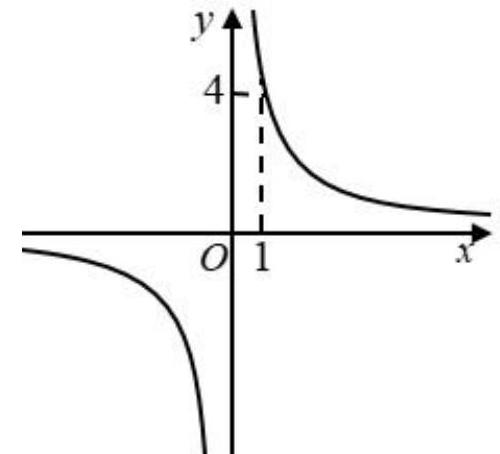

# AVP0594 — Single visual target

MathVista:409 / MV-MATH:952_1 · different type · Numeric representation and conversion

## Shared or similar visual information

The numerical notation 4 in both images.

## Evidence locations

- Left image: The 4 to the left of the positive vertical axis of the circle diagram.
- Right image: The 4 to the left of the indicated height on the vertical axis.

## Mathematical meanings

Left image: The selected tick denotes y-coordinate 4. Right image: The indicated point on the upper-right branch has y-coordinate 4.

## Same mathematical meanings

yes

## Rationales

Both cues identify the same vertical coordinate value, 4. The evidence is the selected axis position or coordinate component in each image.

Only the selected target is annotated. AI visual-review draft; not independently double-annotated by humans.
