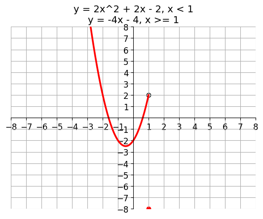
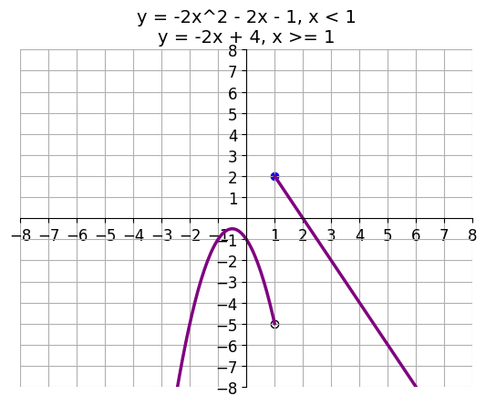

# AVP0596 — Single visual target

DynaMath:88 / DynaMath:87 · same type · Numeric representation and conversion

## Shared or similar visual information

The numerical notation 1 in both images.

## Evidence locations

- Left image: The 1 in the restriction x < 1 in the upper formula.
- Right image: The 1 in the restriction x < 1 on the first branch formula.

## Mathematical meanings

Left image: The first branch is restricted to x-values strictly below the threshold 1. Right image: The first branch uses the input threshold 1 as its excluded right boundary.

## Same mathematical meanings

yes

## Rationales

Each occurrence is the value 1 in x < 1, which specifies the excluded right boundary for the selected branch.

Only the selected target is annotated. AI visual-review draft; not independently double-annotated by humans.
