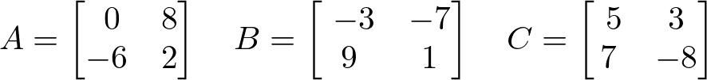
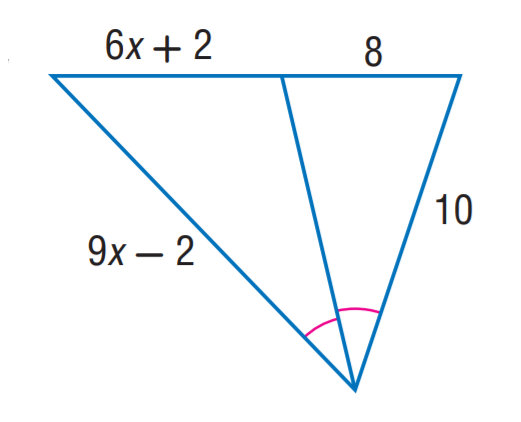

# AVP0597 — Single visual target

DynaMath:489 / MathVista:713 · different type · Numeric representation and conversion

## Shared or similar visual information

The numerical notation 8.

## Evidence locations

- Left image: The notation 8 appears top-right cell of matrix A.
- Right image: The notation 8 appears above the shorter right part of the top edge.

## Mathematical meanings

Left image: 8 is the top-right entry of A. Right image: 8 labels the right part of the split triangle side.

## Same mathematical meanings

no

## Rationales

The notation on the left represents a matrix entry. The notation on the right represents a segment length.

Only the selected target is annotated. AI visual-review draft; not independently double-annotated by humans.
