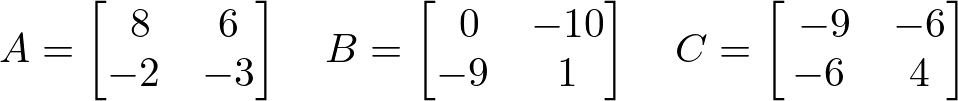
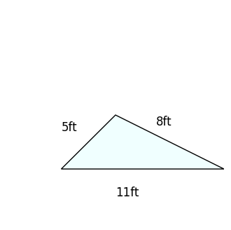

# AVP0598 — Single visual target

DynaMath:487 / DynaMath:70 · different type · Numeric representation and conversion

## Shared or similar visual information

The numerical notations 8 and 8 ft.

## Evidence locations

- Left image: The 8 in the top-left position of matrix A.
- Right image: The 8ft beside the right sloping edge of the triangle.

## Mathematical meanings

Left image: Matrix A has entry 8 at row 1, column 1. Right image: The right sloping triangle side measures eight feet.

## Same mathematical meanings

no

## Rationales

The left context gives the number the role of matrix entry, while the right context gives it the role of length with a specified unit.

Only the selected target is annotated. AI visual-review draft; not independently double-annotated by humans.
