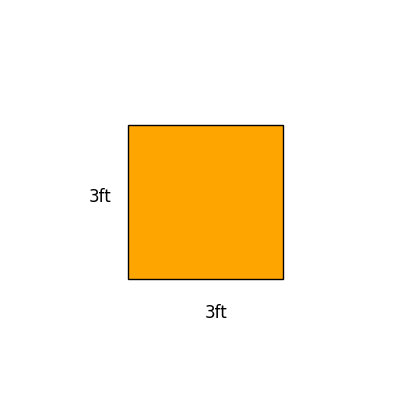
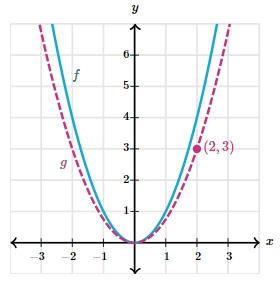

# AVP0599 — Single visual target

DynaMath:9 / MathVerse:570 · different type · Numeric representation and conversion

## Shared or similar visual information

The numerical notations 3 ft and 3.

## Evidence locations

- Left image: The 3ft beneath the bottom side of the orange square.
- Right image: The 3 in the second component of the marked point label (2,3).

## Mathematical meanings

Left image: The square's bottom side measures three feet. Right image: The marked point has y-coordinate 3.

## Same mathematical meanings

no

## Rationales

The left context gives the number the role of length with a specified unit, while the right context gives it the role of vertical coordinate.

Only the selected target is annotated. AI visual-review draft; not independently double-annotated by humans.
