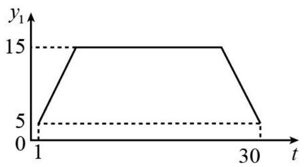
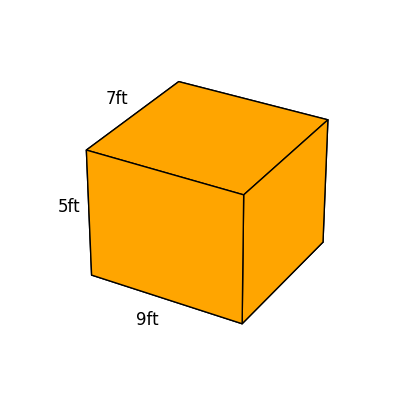

# AVP0601 — Single visual target

MV-MATH:101_1 / DynaMath:60 · different type · Numeric representation and conversion

## Shared or similar visual information

The numerical notations 5 and 5 ft.

## Evidence locations

- Left image: The 5 on the y₁ axis at the level of the lower horizontal dashed guide.
- Right image: The 5ft next to the left vertical edge of the orange rectangular prism.

## Mathematical meanings

Left image: The two end positions shown by the graph have vertical-coordinate value 5. Right image: The left vertical edge measures five feet.

## Same mathematical meanings

no

## Rationales

The left context gives the number the role of vertical coordinate, while the right context gives it the role of length with a specified unit.

Only the selected target is annotated. AI visual-review draft; not independently double-annotated by humans.
