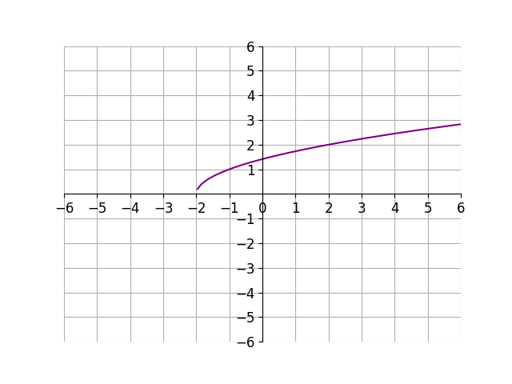
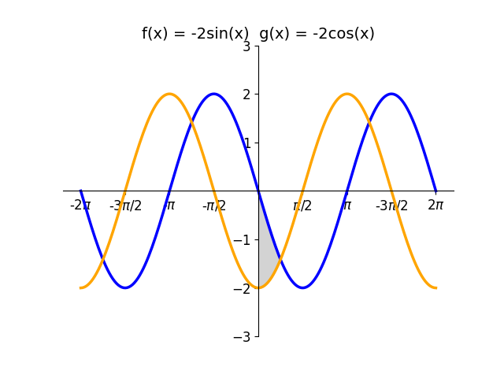

# AVP0602 — Single visual target

DynaMath:199 / DynaMath:144 · same type · Numeric representation and conversion

## Shared or similar visual information

The numerical notation −2 in both images.

## Evidence locations

- Left image: The −2 beneath the left endpoint of the purple curve on the horizontal axis.
- Right image: The signed factor −2 before sin(x) in the first formula above the curves.

## Mathematical meanings

Left image: The left endpoint of the purple curve has x-coordinate negative two. Right image: The output of sin(x) is multiplied by −2 in f(x).

## Same mathematical meanings

no

## Rationales

The left context gives the number the role of horizontal coordinate, while the right context gives it the role of multiplicative coefficient.

Only the selected target is annotated. AI visual-review draft; not independently double-annotated by humans.
