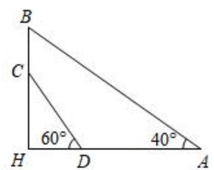
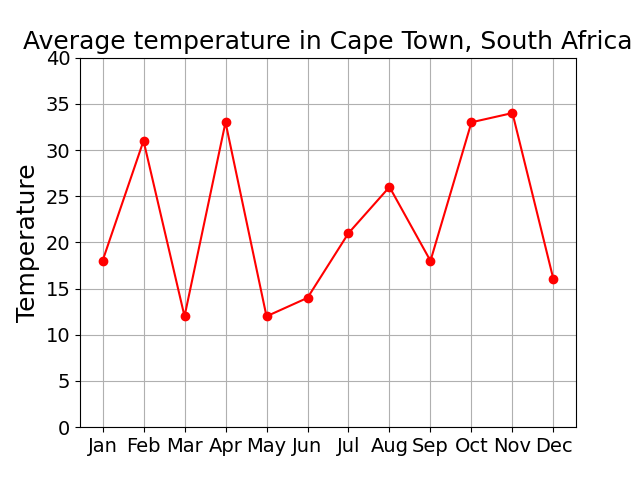

# AVP0603 — Single visual target

MV-MATH:1855_2 / DynaMath:380 · different type · Numeric representation and conversion

## Shared or similar visual information

The numerical notations 40° (left) and 40 (right).

## Evidence locations

- Left image: The notation 40° appears beside the arc at A.
- Right image: The notation 40 appears at the top of the vertical scale.

## Mathematical meanings

Left image: 40° gives the angle at A between AB and AH. Right image: 40 is a tick value on the temperature axis.

## Same mathematical meanings

no

## Rationales

The notation on the left represents an angle measure. The notation on the right represents a temperature scale value.

Only the selected target is annotated. AI visual-review draft; not independently double-annotated by humans.
