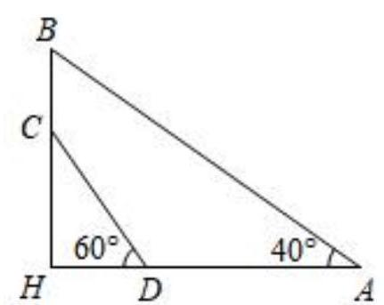
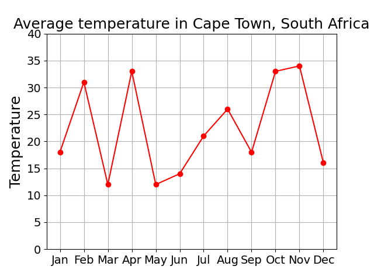

# AVP0603 — Single visual target

MV-MATH:1855_2 / DynaMath:380 · different type · Numeric representation and conversion

## Shared or similar visual information

The numerical notations 40° and 40.

## Evidence locations

- Left image: The 40° inside the large triangle at A.
- Right image: The 40 at the top of the vertical axis labeled Temperature.

## Mathematical meanings

Left image: The angle between AH and AB at A measures 40 degrees. Right image: The selected tick marks a temperature value of 40 on the chart's vertical scale.

## Same mathematical meanings

no

## Rationales

The left context gives the number the role of angle measure, while the right context gives it the role of temperature scale value.

Only the selected target is annotated. AI visual-review draft; not independently double-annotated by humans.
